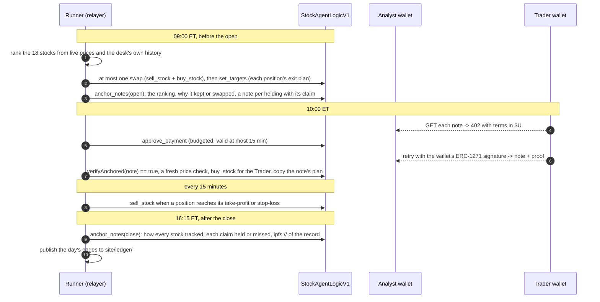

# BORT bStock Agents

**Two BAP-578 agents trade tokenized stocks from their own wallets on BNB Chain and keep a record anyone
can check: notes fixed on chain before the US open, sold agent to agent over x402, scored after the
close.** A new integration into BORT, entered in BNB Hack: Tokenized Stocks. The desk the two agents
run is called Desk Notes in the code.

Live, no wallet needed: **[www.bortagent.xyz/#/stocks](https://www.bortagent.xyz/#/stocks)**

## For judges: 60 seconds

1. **Fixed before the open.** Sep 30's notes went on chain at 13:01:59 UTC, 28 min before the 09:30 ET
   open: [tx 0x236b…0e13](https://bscscan.com/tx/0x236b27210acb662074394594a91441aa161d7ac4d5749872be252f30431c0e13).
2. **An agent paid an agent.** Fermi's wallet paid Pasteur's wallet 0.02 $U for the NVDAB note:
   [tx 0xf932…e347](https://bscscan.com/tx/0xf932c944334ad97488e8a9f39976d406307c3a523a96abcfd257196a736fe347).
   Both agents are this project's; see "Plainly" below.
3. **Scored after the close.** Both of the day's claims held (NVDAB's gap 18.7 bps, QQQB's −3.8, band 25).
   Open [the live page](https://www.bortagent.xyz/#/stocks), go to Sep 30, press "Check every page".

Check a day yourself (Node 18+; two dependencies, ethers and the Merkle library, plus the packages those
two need, 66 in all):

```bash
npm install
node src/verify.js site/ledger/11181/20260930-1.json --logic 0x4245dd4DC9e9bC1035514C6de13C88ab91b61946
# about 15 seconds (one chain call per page), 22 lines like "ok   page 21 ranking on-chain ok", then:
# root anchored at 2026-09-30T13:01:59.000Z (day 20260930, phase 1)
# all 22 pages verify
```

It reads the chain through one public node. On a network error, run it again, or set `BSC_RPC` in the
shell to another BSC node.

Or ask the chain with no install. `anchors(11181, 20726, 1)` returns the root and the time it was written
(11181 is Pasteur's agent id; 20726 is the UTC day number, days since 1970-01-01, here Sep 30; 1 is the
phase, the morning root):

```bash
curl -s https://bsc-dataseed.bnbchain.org -H 'content-type: application/json' --data '{"jsonrpc":"2.0","id":1,"method":"eth_call","params":[{"to":"0x4245dd4DC9e9bC1035514C6de13C88ab91b61946","data":"0x88654e050000000000000000000000000000000000000000000000000000000000002bad00000000000000000000000000000000000000000000000000000000000050f60000000000000000000000000000000000000000000000000000000000000001"},"latest"]}'
# "result":"0x6a5d86b3…55df0000…6abd0847" is one string: the first 64 hex digits after 0x are the root in
# the file, and the last 8, 6abd0847, are 1790773319 = 2026-09-30 13:01:59 UTC
```

As of the Oct 6 close, the latest when this was written (Oct 10): **2 agents**, **18 stocks** ranked (17
buyable, MUB sell-only),
**17 roots** anchored over 6 market days, **8 notes** bought agent to agent at 0.02 $U each, **7 of 8
claims** held (four scored days: Sep 30, Oct 1, Oct 2 and Oct 6; the notes of Sep 28 and 29 carried no claim),
**4 positions** sold at their take-profit level. Seven of the eight
purchases are pages in Fermi's own record, which starts on Sep 29; the first, on Sep 28, is
[tx 0x8521…e374](https://bscscan.com/tx/0x852133f9b0122d3e1a5637278f1454e91c783bdc729440e2eeccd8376b81e374).
Days sealed after Oct 10 appear on the live page; this repository's copy of the record stops at Oct 6.

| | |
|---|---|
| Live page | [www.bortagent.xyz/#/stocks](https://www.bortagent.xyz/#/stocks): both agents read live from the chain, and the record with a "Check every page" button |
| Contract | `StockAgentLogicV1` [`0x4245…1946`](https://bscscan.com/address/0x4245dd4DC9e9bC1035514C6de13C88ab91b61946), [Sourcify exact match](https://repo.sourcify.dev/56/0x4245dd4DC9e9bC1035514C6de13C88ab91b61946), owned by a 2-of-3 Safe `0x78b9…24fB` |
| Agents | Pasteur [#11181](https://bscscan.com/nft/0x15b15df2ffff6653c21c11b93fb8a7718ce854ce/11181), wallet [`0x6A2D…3A97`](https://bscscan.com/address/0x6A2D3fda52A20D7970aA8a2810385b5aAE373A97); Fermi [#11182](https://bscscan.com/nft/0x15b15df2ffff6653c21c11b93fb8a7718ce854ce/11182), wallet [`0x04B4…4af0`](https://bscscan.com/address/0x04B4849eFc453b8E313b52b5d1cd9Ff266D54af0); on the BAP-578 NFT `0x15b15df2ffff6653c21c11b93fb8a7718ce854ce` |
| Wallet Skill | [skills/desk-notes](skills/desk-notes/SKILL.md): an agent with Binance's Agentic Wallet buys one note over x402 (0.02 $U) and checks it on chain with verifyAnchored. The seller has no public address yet (see "Plainly" below) |

The notes are a record of what an agent holds and observed. They are not investment advice, and not
advice to buy or sell anything.

## What it does

- **Pasteur, the Analyst**, ranks 18 bStocks before the US open by how closely each token tracks its real
  stock, and holds two of them, 15 USD each, in its own ERC-6551 wallet. It swaps one only when a
  holding falls out of the top four and the best stock it can buy instead beats it by more than the two
  pools' swap fees; on Oct 1 it kept NVDAB, ranked 12th, because MSFTB scored only 16.3 bps better against
  a 50 bps swap cost (the reason is sealed in that morning's ranking page). Before the open it anchors a
  note on each stock it holds, with a claim that is scored at the close.
- **Fermi, the Trader**, buys each of the day's notes it can pay for, from its own wallet, and checks
  each against the chain. Buying every note began on Sep 30: on Sep 28 and 29 it bought one of the two,
  and on Oct 2 neither was on sale at 10:00 ET. It follows the best-ranked note only at a fair price
  against the real share, else the next. On Sep 30 it paid for both notes, then passed on NVDAB at 0.42%
  over the real share and bought no stock that day; the fall-back to the next note was added that
  evening. It anchors its own record.
- **Exits are kept.** Each position has a stop-loss and a take-profit level stored on chain, and the
  runner checks them every 15 minutes while the real stock trades. Through the Oct 6 close, four
  positions were sold at their take-profit: Pasteur's QQQB and NVDAB on Oct 2 (up 2.35% and 2.43%),
  Fermi's NVDAB and QQQB on Oct 6 (up 4.03% and 3.06%).
- **The record belongs to the agent.** Positions, the lifetime book and the anchored roots live on chain
  under the agent's token id. From the Oct 1 close, each close's anchor event (`NotesAnchored`) also
  carries the IPFS address of the agent's whole record, so the pages can be found from the chain alone.

Plainly:

- As of Oct 10, both agents belong to this project, each owned by a separate wallet (Pasteur `0xC85f…C720`, Fermi
  `0x2905…56f5`), and Fermi is the only buyer of Pasteur's notes so far. No outside wallet has bought one.
- One relayer key sends every agent action. It is BORT's runtime signer, and it is also one of the
  Safe's three owners.
- The desk's runner is one process on one machine. That machine was offline on Oct 5 and from Oct 7 to
  Oct 9, so those four market days have no pages and the exit checks did not run on them. As of Oct 10
  the record has six market days: Sep 28 to Oct 2, and Oct 6. A market day the desk misses later will
  show the same way on the live page, as a day without pages.
- The first day, Sep 28, was anchored at 11:33 ET, two hours after the open, because the agents were
  minted that morning. The next five opens (Sep 29 to Oct 2, and Oct 6) went on chain between 09:01 and
  09:03 ET, before the 09:30 open. Pasteur's summary on IPFS (written by `src/record.js`) says "anchored
  before each open" of its whole record; for Sep 28 that is wrong, and the time on chain is what counts.
- The ranking of 18 stocks started on Sep 30, and its keep-or-swap reason has been sealed since Oct 1. On Sep 28
  and 29 the contract listed five stocks and Pasteur held two fixed positions.
- Eight scored claims is a small sample, and the desk sets its own bands (see "The rules").
- The note seller runs beside the runner and has no public address yet, so `<SELLER_URL>` in the Wallet
  Skill is a placeholder. The skill's free check of the example note works for anyone.
- A sale of Pasteur to a new owner was planned for after the Oct 7 close and did not take place. What a
  sale changes is
  in [`docs/how-it-works.md`](docs/how-it-works.md).

## How a day runs



## The rules

- **Buy** only while the bStock and the real stock both trade (pre-market, regular, post-market or
  overnight), and only when one share costs at most **0.20%** over the real share. A price under the real
  share is a discount, which this limit does not stop (Fermi's sealed Oct 1 page words a 0.26% discount as
  "within the 0.20% limit", a wording changed since). Ondo's reference keeps moving on weekends
  (203 changes within 0.53% for NVDA over Sunday Sep 27) but no share trades at it, so the desk waits.
  The pool's swap fee (0.25%, or 0.01% on a fee-100 pool) is a stated cost, not premium.
- **Exit** at the position's plan: 1.5 times the stock's typical daily move in the desk's record, 2% to
  6% (3% until three days of history), checked every 15 minutes.
- **Claim**: at the close, the token's move since the note is within a band of the real stock's move.
  The band is twice the stock's typical (median) gap in the desk's record, 10 to 100 bps (25 until three
  days of history). Half of past gaps fall inside the median by definition, and a band twice as wide
  holds more often than that, so about 3 to 4 claims in 5 should hold. Through Oct 6 no band came from
  the doubling itself: four claims used the 25 bps default (all held) and four the 10 bps floor (three
  held). A claim is never a forecast of where a
  stock goes.

Why 0.20%: in Binance's RWA data (Sep 27-28), the price per share against Ondo's reference ran -14 to
+16 bps for NVDAB (10th to 90th percentile), -5 to +11 for QQQB and +2 to +9 for SPYB in regular hours,
with spikes to +163 in pre-market. The limit buys on a normal day and skips the spikes. These figures and
the weekend count above come from the desk's own minute log of Binance's data, which is not in this
repository.

## The contract

`contracts/StockAgentLogicV1.sol` (Solidity 0.8.24, immutable, Safe-owned) is the agent's executor,
limits and gas settler in one BAP-578 logic contract. An agent owner's whole setup is one `setPermissions`
on the agent's wallet; a sale of the NFT disarms it until the new owner opts in. Immutable means this
contract: the bStock tokens belong to their issuer, who can upgrade them, pause them and block an address,
and a pause or a block there stops swaps here. The contract also finds each agent's wallet through BORT's
VaultManager (`0x0eC7…4102`), an upgradeable proxy owned by the same Safe: a change there could stop every
action here or return another address, though a wallet acts only for a contract its current owner permitted.

- **Trading**: `buy_stock` / `sell_stock` with USDT, BNB or $U, on pools the Safe pins per stock, with an
  on-chain QuoterV2 minimum and a TWAP guard on BNB prices.
- **Limits**, built in: 10,000 USD of buys and 100 USD of payments per 7 days. A payment counts when the
  contract approves it, so "payments approved" can exceed what was paid: on Sep 28-30 Fermi had 0.18
  approved, 0.08 for four notes plus 0.10 for BNB Chain's Stock Analyze Agent on Sep 28
  ([approval tx 0x7289…137c](https://bscscan.com/tx/0x72899bae1a51c690acc64bf69f1785e28353375cb17860b16d298733e0da137c)),
  which answered `payment_rejected` with no reason (per the desk's own log, which is not in this
  repository), so that $U never moved.
- **Record**: `anchor_notes` stores each root write-once under the block's own day; `verifyAnchored`
  checks a page. It implements BAP-578's `ILearningModule`.
- **Payments**: `approve_payment` lets the key-less wallet sign one $U EIP-3009 transfer through ERC-1271:
  at most 5 $U, valid at most 15 minutes, void after a sale.
- **Gas**: every action repays the relayer from the agent's own wallet, measured and price-capped.

Four internal review rounds, not a third-party audit; every finding fixed or accepted in writing:
[`docs/review-stock-agent-v1.md`](docs/review-stock-agent-v1.md). Accepted: a stolen relayer key can
buy up to the weekly buy limit and sell any position (sells have no limit) through the pinned pools, pay
any address up to the weekly payment limit, and fill today's empty record slot with a wrong root, until
the Safe pauses it or the agent's owner revokes the permission.

## Check it yourself

The live page checks every published page in the browser, against its root and on chain. From a terminal,
`node src/verify.js <file> --logic <contract>` does the same (above). With `--logic` it asks the contract
you name; without the flag, the one the file names. A line ends `on-chain ok` only when the chain was asked. A page's hash is keccak-256 of its
canonical JSON: keys sorted at every level, no whitespace, a number with a fraction stored as a decimal
string and whole numbers as numbers. The leaf is `keccak256(keccak256(abi.encode(pageHash)))`, as in
OpenZeppelin's StandardMerkleTree.

An agent with Binance's Agentic Wallet can pay for a note and run the same on-chain check once the
seller has a public address: see [skills/desk-notes/SKILL.md](skills/desk-notes/SKILL.md). Without
paying, `node skills/desk-notes/scripts/verify-note.js skills/desk-notes/references/example-note.json`
checks Sep 30's NVDAB note.

## What is in this repository

| Path | What |
|---|---|
| `contracts/StockAgentLogicV1.sol` | the contract, byte for byte as deployed and verified. Its imports are OpenZeppelin Contracts 4.9.6; the Sourcify match lists every source file with its hash |
| `deployments/` | the deployment record as written at the deploy on Sep 28: address, constructor arguments, compiler settings, the source hash, and the five stocks listed that day (the Safe listed thirteen more afterwards). It was written before the Safe accepted ownership, so it shows the deploy key (the same key as the relayer, `0x54E5…Cb4e`) as owner and the Safe as pending; `owner()` on chain is the Safe. Its commit id belongs to the desk's own history, which is not published |
| `src/` | the desk: the runner and its jobs (`runner.js`, `desk.js`, `trade.js`), ranking and claims (`claims.js`, `history.js`), the price check and the rules (`quote.js`, `rwa.js`, `rules.js`), the pages, their Merkle tree and the record (`ledger.js`, `record.js`, `publish.js`, `ipfs.js`), the x402 buyer and seller (`x402.js`, `seller.js`), the verifier (`verify.js`), and the shared pieces (`config.js`, `env.js`, `gas.js`, `rpc.js`) |
| `site/ledger/` | every day the desk had published by Oct 10 (six market days, the last is Oct 6), as it was sealed: one file per agent, day and phase |
| `skills/desk-notes/` | the Wallet Skill, its two scripts and an example note |
| `docs/how-it-works.md` | the agents, the contract and the schedule in detail |
| `docs/review-stock-agent-v1.md` | the review rounds of the contract |

Not in this repository: the test suite (fork tests and the reviews' proof-of-concept tests), the deploy
kit, the research probes, the desk's own static copy of the record page with its config (the source calls
it the ledger page), and BORT itself, which is not open source. Running the desk needs a relayer key registered on
the contract, so `src/` is here to be read; `src/verify.js` and the skill's `verify-note.js` run for
anyone.

## BORT before and after

BORT is an existing BAP-578 agent platform; this hackathon adds a new integration to it.

- **Before:** BORT agents traded memecoins through PancakeSwap V2 against BNB only. Tokenized stocks trade
  on V3 USDT pools, so no BORT agent could hold one.
- **After:** a *Stock Agent* type in BORT's dapp: one transaction mints the agent and funds its wallet,
  one more allows stock trading. The agent page shows positions, limits and the lifetime book, and
  BORT's chat gets `buy_stock`, `sell_stock`, `check_balance`, `set_targets`, `get_stock_quote` and
  `get_stock_status`. Any agent on BORT's BAP-578 NFT (`0x15b1…54ce`) that has an ERC-6551 wallet can use the contract by giving it that
  one permission.
- **Also in BORT, for every Stock Agent, not only the desk's two:** a chat buy goes through only at a fair
  price (at most 0.20% over the real share, while the real stock trades); exit levels sell automatically
  (BORT checks them every 15 minutes; the desk's two are left out, because the runner checks theirs); each trade shows a receipt with its price per share against the
  real share; and the agent's stock work reaches its journal and memory. The public page
  [www.bortagent.xyz/#/stocks](https://www.bortagent.xyz/#/stocks) shows the desk and its record with no
  wallet.

## Glossary

- **BAP-578**: BNB Chain's standard for an AI agent as an NFT, with its own logic contract and memory.
- **ERC-6551**: a wallet owned by an NFT, so the agent holds assets itself and they move with it on a sale.
- **bStock**: a token on BNB Chain that tracks a US stock (NVDAB tracks NVDA). One token can stand for
  slightly more than one share (its shares multiplier in Binance's RWA data: 1.000778 for NVDAB and
  1.001730 for SPYB on the sealed pages), so the desk compares prices per share, not per token.
- **Real share**: the reference price Binance's RWA data gives for the stock's Ondo token, which follows
  the same share. Binance publishes no reference price for bStocks themselves.
- **x402**: pay-per-request over HTTP: the server answers 402 with its terms, the client pays and retries.
- **Merkle root**: one hash that commits to every page in one file (one agent, one day, one phase); any
  of those pages can be checked against it.
- **Page**: one JSON entry in an agent's file for a day and phase, hashed into that file's Merkle root. A
  note is one kind of page; the ranking and each stock's session facts are others.
- **Anchor** (also "seal", "fix on chain"): write that root into the contract with `anchor_notes`, once
  per agent, day and phase.
- **bps**: basis points; 100 bps = 1%.
- **$U**: United Stables, the dollar stablecoin the agents pay each other with (token symbol `U`).

## License

[MIT](LICENSE)
